# Las páginas de BrandIA · app.brandiamos.com

**La dirección oficial es https://app.brandiamos.com.** Todo se prueba y se comparte ahí. La misma web responde
también en https://build101-bice.vercel.app (la dirección automática de Vercel), pero no se usa para mostrar.

Cada push a `main` se publica solo en las dos. **Toda página nueva se suma a este registro**: qué es, cómo se
llega, a dónde lleva y qué necesita para funcionar.

Relevado el sábado 17/10 a las 17:30, sobre `main`. Las 15 páginas cargan en app.brandiamos.com. A las 17:50 se
conectó la portada con la app: sus botones "BrandIAmos" llevan a `/crear`.

## El mapa

Las flechas son botones o links. Las punteadas son "volver" o "empezá por acá" (aparecen si falta un paso anterior).

```mermaid
flowchart LR
  portada["/ · Portada<br/>(web original)"]
  espera["/lista-de-espera"]
  crear["/crear<br/>Paso 1 · Contanos<br/>(chat, escrito o con audio)"]
  marca["/crear/marca<br/>Paso 2 · Tu marca<br/>nombres, caminos, brandbook"]
  contenido["/crear/contenido<br/>Paso 3 · Tu contenido<br/>feed"]
  branderia["/crear/branderia<br/>Paso 4 · Tus productos<br/>BranderIA"]
  web["/crear/web<br/>Tu web"]
  prox["/crear/proximamente<br/>Lo que viene"]
  proxweb["/crear/proximamente/web"]
  proxotras["/crear/proximamente/<br/>redes · pauta · newsletter ·<br/>linkedin · x · branderia"]
  costos["/costos<br/>(solo el equipo, con contraseña)"]

  crear -->|Armar mi marca| marca
  marca -->|Ver mis contenidos| contenido
  marca -->|Armar mi web| web
  contenido -->|Ver mis productos| branderia
  web -->|Ver cómo va a funcionar| proxweb
  proxweb -->|Armar mi web| web
  prox --> proxweb
  prox --> proxotras
  proxotras -.->|Lo que viene| prox
  proxweb -.->|Lo que viene| prox

  marca -.->|Volver a la entrevista| crear
  contenido -.->|Volver a tu marca| marca
  branderia -.->|Volver a tu contenido| contenido

  portada -->|BrandIAmos · Quiero BrandIAr mi marca| crear
  espera ~~~ portada
  costos ~~~ espera
```

En todas las páginas de la app, el logo de BrandIA de arriba lleva a la portada (`/`).

## Lo que no está conectado (revisar antes de la demo)

1. **El formulario de la portada no guarda.** Los botones de la portada ya llevan a la app, pero el formulario de
   abajo ("BrandIAmos la tuya →") solo muestra "Listo" y **no guarda los datos**: no está conectado a nada.
2. **"Lo que viene" (`/crear/proximamente`) no tiene entrada desde el recorrido.** Solo se llega con el link o
   desde la web del cliente. Juan Pedro iba a sumar el acceso desde `/crear`.
3. **La lista de espera no guarda.** `/lista-de-espera` tiene vacíos los datos de Supabase y del webhook: el
   formulario no manda nada. Falta conectarlo (ver `brandia/referencias/landing-waitlist/`).
4. **`/costos` no tiene links a propósito**: es solo para el equipo.

## Todo vive en la pestaña

La ficha, la marca, el feed y lo demás se guardan en el navegador, **solo en esa pestaña** (`sessionStorage`).
Por eso:

- Cada página del recorrido necesita la anterior **en la misma pestaña**. Si alguien abre `/crear/marca` en una
  pestaña nueva, ve "Primero, contanos tu negocio" con un botón a `/crear`.
- Si se cierra la pestaña, se pierde la marca. Para la demo: todo en una sola pestaña, de punta a punta.
- Recargar no vuelve a generar lo que ya está terminado (queda guardado en la pestaña). Lo que estaba a medio
  generar sí se pierde: por ejemplo, la web del cliente si se recarga mientras se arma. Si una pantalla se recarga
  más de 3 veces en 2 minutos, deja de pedirle a la IA y muestra un botón para hacerlo a mano (freno de gasto).

Lo que guarda cada paso: `brandia:ficha` (entrevista), `brandia:nombres`, `brandia:direcciones`,
`brandia:identidad` (marca), `brandia:feed` (contenido), `brandia:branderia` (fotos de productos) y
`brandia:web` (web del cliente).

## Página por página

### Fuera de la app

| Dirección | Qué es | Cómo se llega | Lleva a | Estado |
|---|---|---|---|---|
| `/` | La portada: la web original de BrandIA tal cual (`apps/web/public/brandia.html`) | Es la dirección principal | **A la app (`/crear`)** con "BrandIAmos" (barra de arriba), "Quiero BrandIAr mi marca →" (inicio) y "BrandIAmos →". Los demás links ("Cómo funciona", "Productos"…) bajan dentro de la misma portada | Funciona. El formulario de abajo no guarda |
| `/lista-de-espera` | La landing de lista de espera, tal cual (`public/lista-de-espera.html`) | Solo con el link | A ningún lado | Carga. El formulario no guarda |
| `/costos` | Panel del equipo: saldo del AI Gateway, costo de cada paso y de una marca completa | Solo con el link. Pide contraseña (`COSTOS_CLAVE`, la tiene Eze) | — | Funciona |

### El recorrido (la demo)

| Dirección | Qué es | Cómo se llega | Lleva a | Necesita | IA que usa |
|---|---|---|---|---|---|
| `/crear` | **Paso 1 · Contanos.** Entrevista por chat. La persona escribe o manda audios con el micrófono de la caja (se pasan a texto con ElevenLabs); BrandIA contesta por escrito. Termina en la ficha de la marca | Los botones "BrandIAmos" de la portada, directo, o desde los "empezá por acá" de las otras páginas | "Armar mi marca" → `/crear/marca` | Nada | `/api/entrevista` (chat) y `/api/transcribir` (audio a texto) |
| `/crear/marca` | **Paso 2 · Tu marca.** Arriba, "Un nombre con historia": 5 nombres con su porqué y "Otros nombres". Abajo, tres caminos para elegir. Después, el brandbook con logos | "Armar mi marca" desde `/crear` | "Ver mis contenidos" → `/crear/contenido` · "Armar mi web" → `/crear/web` · "Volver a la entrevista" → `/crear` | La ficha (paso 1) | `/api/nombres`, `/api/direcciones`, `/api/identidad`, `/api/logo` |
| `/crear/contenido` | **Paso 3 · Tu contenido.** El feed con la marca aplicada: posteos, carrusel, historias y reel | "Ver mis contenidos" desde el brandbook | "Ver mis productos" → `/crear/branderia` · "Volver a tu marca" → `/crear/marca` | La marca (paso 2) | `/api/contenidos/lote` |
| `/crear/branderia` | **Paso 4 · Tus productos (BranderIA).** La IA saca la foto de cada producto y el logo real cae encima. Kit en un carrito y botón "Cotizar" (en construcción: no se cotiza ni se cobra nada) | "Ver mis productos" desde el feed | "Volver a tu contenido" → `/crear/contenido` | La marca (paso 2) | `/api/contenidos/imagen` |
| `/crear/web` | **Tu web.** Mini entrevista, la IA arma la web con la marca del cliente y se cambia por chat. Dominio y publicar siguen en construcción | "Armar mi web" desde el brandbook o desde `/crear/proximamente/web` | "Ver cómo va a funcionar" → `/crear/proximamente/web` | La marca (paso 2) | `/api/web/entrevista`, `/api/web/armar`, `/api/web/cambio` |

Si falta lo que "Necesita", la página muestra un aviso con un botón a `/crear`.

### "Lo que viene": pantallas en construcción, sin IA

| Dirección | Qué muestra | Cómo se llega |
|---|---|---|
| `/crear/proximamente` | El índice de lo que viene, con una tarjeta por pantalla | Solo con el link, o "Lo que viene" desde cada pantalla |
| `/crear/proximamente/redes` | Todas tus redes en un solo lugar: cuentas y calendario | Desde el índice |
| `/crear/proximamente/pauta` | Pauta en Meta: qué funciona en tu rubro (siguiente etapa) | Desde el índice |
| `/crear/proximamente/newsletter` | Newsletter con tu voz y tu diseño | Desde el índice |
| `/crear/proximamente/linkedin` | Publicaciones de LinkedIn | Desde el índice |
| `/crear/proximamente/x` | Mensajes cortos para X | Desde el índice |
| `/crear/proximamente/web` | Cómo va a funcionar la web, con botón "Armar mi web" → `/crear/web` | Desde el índice o desde `/crear/web` |
| `/crear/proximamente/branderia` | Cómo funciona BranderIA, con un kit de muestra (sin pedidos reales) | Desde el índice |

Todos los textos de muestra están marcados como ejemplo: nada de esto lo generó la IA.

## Solo en la compu

  propósito).

## Cómo mantener este registro

Cuando sumes o cambies una página:

1. Agregala a la tabla que corresponda y al mapa (cómo se llega, a dónde lleva, qué necesita, qué IA usa).
2. Probala en https://app.brandiamos.com, en compu y en celular, antes de darla por terminada.
3. Si la página llama a la IA sola al cargar, ponele el freno de recargas (`puedoArrancarSolo` de
   `apps/web/src/lib/freno.ts`) y envolvé su ruta con `medir()` (ver `apps/web/src/lib/ia/README.md`).
