# Las páginas de BrandIA · app.brandiamos.com

**La dirección oficial es https://app.brandiamos.com.** Todo se prueba y se comparte ahí. La misma web responde
también en https://build101-bice.vercel.app (la dirección automática de Vercel), pero no se usa para mostrar.

Cada push a `main` se publica solo en las dos. **Toda página nueva se suma a este registro**: qué es, cómo se
llega, a dónde lleva y qué necesita para funcionar.

Relevado el sábado 17/10 a las 17:30, sobre `main`. Las 15 páginas cargan en app.brandiamos.com. A las 17:50 se
conectó la portada con la app: sus botones "BrandIAmos" llevan a `/crear`.

## El mapa

Las flechas son botones o links. Las punteadas son "volver" o "empezá por acá" (aparecen si falta un paso anterior).

```mermaid
flowchart LR
  portada["/ · Portada<br/>(web original)"]
  espera["/lista-de-espera"]
  crear["/crear<br/>Paso 1 · Contanos<br/>(chat, escrito o con audio)"]
  marca["/crear/marca<br/>Paso 2 · Tu marca<br/>nombres, caminos, brandbook"]
  contenido["/crear/contenido<br/>Paso 3 · Tu contenido<br/>feed"]
  branderia["/crear/branderia<br/>Paso 4 · Tus productos<br/>BranderIA"]
  web["/crear/web<br/>Tu web"]
  publicada["/w/[slug]<br/>La web publicada<br/>(link y QR)"]
  prox["/crear/proximamente<br/>Lo que viene"]
  proxweb["/crear/proximamente/web"]
  proxotras["/crear/proximamente/<br/>redes · pauta · newsletter ·<br/>linkedin · x · branderia"]
  costos["/costos<br/>(solo el equipo, con contraseña)"]
  pedidos["/pedidos<br/>(solo el equipo, con contraseña)"]
  planes["/crear/planes<br/>Planes<br/>(precios y pagar)"]
  cuenta["/crear/cuenta<br/>Tu cuenta<br/>(entrar, tus marcas, tu plan)"]
  mp["Mercado Pago<br/>(página de pago)"]

  crear -->|Armar mi marca| marca
  marca -->|Ver mis contenidos| contenido
  marca -->|Crear mi sitio web · pestaña nueva| web
  contenido -->|Ver mis productos| branderia
  contenido -->|Crear mi sitio web · pestaña nueva| web
  branderia -->|Crear mi sitio web · pestaña nueva| web
  web -->|Ver cómo va a funcionar| proxweb
  web -->|Me gusta, quiero publicarla| publicada
  proxweb -->|Armar mi web| web
  prox --> proxweb
  prox --> proxotras
  proxotras -.->|Lo que viene| prox
  proxweb -.->|Lo que viene| prox
  prox -->|Mirá los planes| planes
  planes -->|Suscribirme · Comprar mi marca| mp
  ingresar["/ingresar<br/>Entrar<br/>(correo y código)"]
  planes -.->|si no entró| ingresar
  ingresar -->|Entrar| cuenta
  mp -->|vuelve con ?pago=| cuenta
  cuenta -->|Abrir una marca| marca
  cuenta -->|Ver los planes| planes

  marca -.->|Volver a la entrevista| crear
  contenido -.->|Volver a tu marca| marca
  branderia -.->|Volver a tu contenido| contenido

  portada -->|BrandIAmos · Quiero BrandIAr mi marca| crear
  espera ~~~ portada
  costos ~~~ espera
  branderia -->|Pedir cotización · el pedido llega a| pedidos
```

En todas las páginas de la app, el logo de BrandIA de arriba lleva a la portada (`/`). En las de `/crear`, la barra
de arriba suma tres links: **"Lo que viene"** (`/crear/proximamente`), **"Planes"** (`/crear/planes`) y
**"Entrar"** (`/ingresar`) o **"Tu cuenta"** (`/crear/cuenta`); en celular es un ícono de persona.

## Lo que no está conectado (revisar antes de la demo)

1. **La lista de espera no guarda.** `/lista-de-espera` tiene vacíos los datos de Supabase y del webhook: el
   formulario no manda nada. Falta conectarlo (ver `brandia/referencias/landing-waitlist/`).
2. **`/costos` y `/pedidos` no tienen links a propósito**: son solo para el equipo.
3. **Los correos para entrar solo les llegan al equipo.** Supabase manda con su servidor de correo de prueba: solo
   a los correos del equipo, pocos por hora y sin el código (solo el enlace). Antes de abrir las cuentas a clientes
   hay que configurar un servidor de correo propio (por ejemplo Resend, con brandiamos.com) en Supabase →
   Authentication → Emails → SMTP Settings, y ahí poner la plantilla con el código.

## La imagen al compartir el link

Cuando se pega un link de app.brandiamos.com en WhatsApp o en redes, aparece `apps/web/public/compartir.png`
(1200 × 630): la B naranja, el logotipo oficial y "Que se vea tan bien como lo que hacés." La portada la declara en
su `<head>` (`brandia.html`) y la app, en `apps/web/src/app/layout.tsx`, para todas sus páginas. **Las webs de los
clientes (`/w/[slug]`) no la usan**: se comparten con su título y descripción, sin la imagen de BrandIA. La lista
de espera todavía no tiene imagen. La fuente de la imagen está en `brandia/marca/compartir/`.

## Todo vive en la pestaña

La ficha, la marca, el feed y lo demás se guardan en el navegador, **solo en esa pestaña** (`sessionStorage`).
Por eso:

- Cada página del recorrido necesita la anterior **en la misma pestaña**. Si alguien abre `/crear/marca` en una
  pestaña nueva, ve "Primero, contanos tu negocio" con un botón a `/crear`.
- Si se cierra la pestaña, se pierde la marca, **salvo que la persona haya entrado a su cuenta** (ver abajo, "La
  marca en la cuenta"). Para la demo: todo en una sola pestaña, de punta a punta.
- Recargar no vuelve a generar lo que ya está terminado (queda guardado en la pestaña). Lo que estaba a medio
  generar sí se pierde: por ejemplo, la web del cliente si se recarga mientras se arma. Si una pantalla se recarga
  más de 3 veces en 2 minutos, deja de pedirle a la IA y muestra un botón para hacerlo a mano (freno de gasto).

Lo que guarda cada paso: `brandia:ficha` (entrevista), `brandia:nombres`, `brandia:direcciones`,
`brandia:identidad` (marca, con el logo elegido y todas las paletas probadas), `brandia:feed` (contenido, con los
feeds anteriores), `brandia:me-gusta` (piezas del feed marcadas), `brandia:branderia` (fotos de productos, sugeridos
para el rubro y fotos anteriores) y
`brandia:web` (web del cliente).

### La marca en la cuenta

Si la persona entró a su cuenta (`/ingresar`), **todo lo de la pestaña se guarda solo en su cuenta** cada pocos
segundos y al irse de la pestaña: cada clave `brandia:…` es un archivo en la carpeta privada `marcas` de Supabase
Storage (`marcas/<su id>/<id de la marca>/<parte>.json`) y en la tabla `marcas` queda el resumen (nombre, rubro,
colores y hasta dónde llegó). Sube directo del navegador a Supabase, sin pasar por nuestro servidor (Vercel corta
los pedidos de más de 4,5 MB y los logos van adentro). Cada pestaña sube solo lo que cambió en ella: así la pestaña
de la web y la de la marca no se pisan. Si entra después de armar la marca, se guarda apenas entra.

En `/crear/cuenta` están sus marcas: **"Abrir"** la baja entera a la pestaña y lleva al último paso al que llegó,
sin pedirle nada a la IA. Si en la pestaña se reinicia la entrevista, la marca nueva se guarda aparte. El código
está en `apps/web/src/lib/marcas-cuenta.ts` y `apps/web/src/components/cuenta/sincronizar-marca.tsx`.

## Página por página

### Fuera de la app

| Dirección | Qué es | Cómo se llega | Lleva a | Estado |
|---|---|---|---|---|
| `/` | La portada: la web original de BrandIA tal cual (`apps/web/public/brandia.html`) | Es la dirección principal | **A la app (`/crear`)** con "BrandIAmos" (barra de arriba), "Quiero BrandIAr mi marca →" (inicio), "BrandIAmos →" y el botón gigante "¿BrandIAmos?" (abajo de todo). Los demás links ("Cómo funciona", "Productos"…) bajan dentro de la misma portada | Funciona. Abajo de todo, un solo botón gigante "¿BrandIAmos?" que lleva a `/crear` (sin formulario ni textos). La sección de productos se llama BranderIA ("lo producimos y te lo mandamos", sin proveedores) |
| `/lista-de-espera` | La landing de lista de espera, tal cual (`public/lista-de-espera.html`) | Solo con el link | A ningún lado | Carga. El formulario no guarda |
| `/w/[slug]` | **La web publicada de un cliente** (por ejemplo `/w/hoy-rueda`), con SU marca (el logo elegido, sus tipografías y su paleta): sin la barra de BrandIA, solo un "Hecha con BrandIA" chico al final. Si la dirección no existe, "Acá no hay ninguna web" | El link o el QR que entrega `/crear/web` | Los botones de la web (WhatsApp, mapa, Instagram…) · "BrandIA" del pie → `/` | Funciona. Lee la tabla `webs` de Supabase; no usa IA |
| `/costos` | Panel del equipo: saldo del AI Gateway, costo de cada paso, de una marca completa y de cada cliente de punta a punta | Solo con el link. Pide contraseña (`COSTOS_CLAVE`, la tiene Eze) | — | Funciona |
| `/pedidos` | Panel del equipo: los pedidos de BranderIA (marca, colores, productos, cantidades, contacto con link a WhatsApp y a dónde mandarlo). Se cambia el estado de cada uno: recibido, cotizado, en producción, en camino, entregado o cancelado | Solo con el link. La misma contraseña que `/costos` | — | Necesita la tabla `pedidos_branderia` de Supabase (`apps/web/supabase/pedidos-branderia.sql`) |
| `/pruebas` | **Panel del equipo: todo lo que se generó en cada prueba.** Un cliente por pestaña que usó la app (con el nombre de su marca, el rubro y por qué pasos pasó), del más nuevo al más viejo | Solo con el link. Pide la misma contraseña que `/costos` | Cada cliente → `/pruebas/[cliente]` | Funciona. Lee la tabla `pruebas` de Supabase (`apps/web/supabase/pruebas.sql`); no usa IA |
| `/pruebas/[cliente]` | Una prueba entera. Arriba, lo que se generó dibujado como en la app, con los mismos componentes: la entrevista como chat, los nombres en tarjetas, los tres caminos (y cuál eligió), el brandbook con sus logos, el feed, las fotos de BranderIA y la web. Abajo, el historial: cada pedido a la IA con lo que se mandó y lo que volvió. "Bajar todo (JSON)" la descarga entera | Desde `/pruebas` | "Todas las pruebas" → `/pruebas` | Funciona. Las imágenes y audios están en la carpeta `pruebas` de Supabase Storage |

### El recorrido (la demo)

| Dirección | Qué es | Cómo se llega | Lleva a | Necesita | IA que usa |
|---|---|---|---|---|---|
| `/crear` | **Paso 1 · Contanos.** Entrevista por chat. La persona escribe o manda audios con el micrófono de la caja (se pasan a texto con ElevenLabs); BrandIA contesta por escrito. Termina en la ficha de la marca | Los botones "BrandIAmos" de la portada, directo, o desde los "empezá por acá" de las otras páginas | "Armar mi marca" → `/crear/marca` | Nada | `/api/entrevista` (chat) y `/api/transcribir` (audio a texto) |
| `/crear/marca` | **Paso 2 · Tu marca.** Arriba, "Un nombre con historia": 5 nombres con su porqué y ♥, "Otros nombres" (se suman, no reemplazan, y siguen lo marcado), con una **guía fija** que escribe la persona (vale para todas las vueltas) y un **estilo** para pedir una vuelta de un solo tipo ("Por sigla", "Con tu nombre", "Palabra nueva"…), "Variantes de «el elegido»" y "¿Se te ocurrió otro?" para escribir uno propio. Abajo, los caminos para elegir, con colores sacados del negocio: ♥ al camino y a cada color, "Probar otros colores" en cualquier camino (la variante se suma al lado y conserva los colores marcados) y "Otros caminos" con un pedido en palabras (suma tres más). Después, el brandbook con logos: esencia (con misión y visión), logo (se elige entre las propuestas, el símbolo con el nombre o el símbolo solo, con ♥ en cada uno; "Otros logos" suma más siguiendo lo marcado y un pedido, y "Con las iniciales" pide tres con las iniciales o la sigla como protagonista; si el nombre es una sigla, una de las propuestas siempre es así; ese logo es el que usan el feed, BranderIA y las descargas; debajo, **"Tu logo, en sus 4 versiones"**, que salen siempre del logo elegido arriba: completo, solo el nombre, solo el símbolo y en negativo. Si el elegido es una propuesta de imagen, la IA le saca el texto para dejar solo el símbolo: una sola vez por logo, al elegirlo, y queda guardado; si falla, avisa, usa el símbolo SVG y hay un botón para probar de nuevo), paleta (♥ en cada color y "Otra paleta" con un pedido: los marcados se quedan, cambia el resto; todas las paletas quedan para volver), tipografías, voz y tono y cómo se usa. "Tus archivos": **solo lo final** en un .zip (las 4 versiones del logo elegido, el símbolo SVG si es el de la marca, la paleta y las tipografías que quedaron y el brandbook; las pruebas no viajan) y el brandbook en PDF: A4, tapa en el color principal, capítulos numerados con portadilla a sangre en un color de la paleta y el símbolo gigante de marca de agua, un bloque de color por página y el logo sobre cada color de la paleta; cada sección en hoja nueva y sin cortar nada entre hojas. Los PNG del logo salen de 2048 px | "Armar mi marca" desde `/crear` | "Ver mis contenidos" → `/crear/contenido` · "Crear mi sitio web" → `/crear/web` en pestaña nueva · "Volver a la entrevista" → `/crear` | La ficha (paso 1) | `/api/nombres`, `/api/direcciones`, `/api/identidad`, `/api/logo`, `/api/logo/simbolo` (gpt-image-2, paso `logo-simbolo` en `/costos`), `/api/paleta` |
| `/crear/contenido` | **Paso 3 · Tu contenido.** Con una marca nueva, antes de generar: **«¿Cuál te gusta más?»**, dos estilos de diseño lado a lado (Impacto: foto a sangre y panel de color · Editorial: mucho aire, foto recortada en formas y letras grandes), cada uno con tres piezas de muestra compuestas en el momento con su marca (colores, letras y logo) y dos fotos de su rubro que saca la IA en ese momento (una sola vez por marca; mientras llegan ya se puede elegir), con los textos marcados "Ejemplo". Elige uno y recién ahí se genera; el estilo queda guardado con el feed (si ya hay uno guardado, no se pregunta) y "Sumar otro feed" deja cambiarlo ("Estilo del próximo"). El feed con la marca aplicada: posteos, carrusel, historias y reel. Primero, **el perfil de Instagram dentro de un celular**: usuario, avatar con el logo elegido (o el símbolo), la bio que escribió la IA, una historia destacada por pilar del plan (ícono y nombre corto elegidos por la IA de una lista cerrada; mientras tanto o si falla, el símbolo de la marca) y la grilla de 3 columnas con el primer lienzo de cada pieza (posteo, primera lámina del carrusel, portada del reel; recortado a 4:5): tocar una lleva a su tarjeta. Después, **el calendario del mes**: cada pieza en su día y su hora (los que puso la IA en el plan, sin IA nueva), desde el próximo lunes; en celular, una agenda día por día. Tocar una pieza lleva a su tarjeta; las otras tres semanas quedan para el plan mensual, con link a `/crear/planes`. "Antes de publicar" junta los datos que la IA dejó «[a confirmar]»: cada uno tiene un campo para escribirlo o un botón "No va", y "Aplicar" hace que la IA reescriba solo las piezas que los usan (con el dato tal cual, o sin él); las imágenes no cambian y lo aplicado queda guardado en la pestaña. Cada pieza tiene ♥ (me gusta) y descarga (PNG listos para subir y su texto); "Descargar todo el contenido" baja el feed entero en un .zip. "Sumar otro feed" no borra: los anteriores quedan en "Tus feeds" y lo marcado con ♥ guía al nuevo | "Ver mis contenidos" desde el brandbook | "Ver mis productos" → `/crear/branderia` · "Crear mi sitio web" → `/crear/web` en pestaña nueva · "Volver a tu marca" → `/crear/marca` | La marca (paso 2) | `/api/contenidos/muestra` (gpt-image-2, 2 fotos para elegir el estilo) · `/api/contenidos/lote` (recibe `gustaron` y `estilo`) · `/api/contenidos/destacadas` (Claude Haiku, un pedido por feed, guardado en la pestaña) · `/api/contenidos/completar` (Claude, solo al tocar "Aplicar"; una llamada por pieza afectada) |
| `/crear/branderia` | **Paso 4 · Tus productos (BranderIA).** La barra de arriba dice BranderIA. Al entrar, una pantalla de carga (logo de BranderIA, barra y en qué está) mientras la IA elige 10 productos para ese rubro (con su porqué) y les saca la foto: se muestran completos cuando están todas. Cada producto tiene ♥. "¿Te falta algo?" agrega lo que se pida en palabras y "Otras 5 opciones" suma más en la línea de lo marcado; lo nuevo aparece cuando sus fotos están listas y nada se borra. El logo impreso es el elegido en el brandbook; "Sacar fotos nuevas" deja las anteriores como alternativas: recibe el logo real como referencia y lo imprime siguiendo el material (a diferencia del feed, acá el logo sí lo dibuja la IA). Kit en un carrito con **cantidades libres**: − y + y una barra deslizable, en la escala que propone la IA para cada producto (mínima, de a cuánto y la típica: un cartel desde 1, las tarjetas de a 50 o 100; si no vino, desde 1 y de a 1). **"Pedir cotización"**: la persona deja nombre, WhatsApp o mail, a dónde mandarlo y una nota; el pedido **se guarda de verdad** (tabla `pedidos_branderia`) y **se abre WhatsApp** (wa.me) con el mensaje listo para el WhatsApp de BrandIA: «Hola, soy <marca>. Este es mi pedido: …», cada producto con cantidad y detalle, total, datos y el número BR-xxxx. Si no se pudo guardar, WhatsApp se abre igual. La confirmación muestra el número, los pasos y el botón "Mandar por WhatsApp" (por si el navegador bloqueó la ventana). **El número de BrandIA va en `WHATSAPP_BRANDIA` (`apps/web/src/lib/pedidos.ts`)**, hoy el provisorio 095 829 024: si quedara vacío, el botón dice "Falta configurar el WhatsApp de BrandIA". No se cobra: el equipo lo ve en `/pedidos` | "Ver mis productos" desde el feed | "Volver a tu contenido" → `/crear/contenido` · "Crear mi sitio web" → `/crear/web` en pestaña nueva | La marca (paso 2) | `/api/branderia/sugerir` (Claude) y `/api/branderia` (gpt-image-2, una foto por pedido, 4 a la vez) · `/api/branderia/pedido` guarda el pedido (sin IA) |
| `/crear/web` | **Tu web.** Mini entrevista, la IA arma la web con la marca del cliente (con fotos generadas si la persona lo pide, marcadas como ilustrativas) y se cambia por chat. La web lleva la marca completa del brandbook: el **logo elegido** (sin el fondo blanco; si eligió el símbolo, el isotipo con el nombre), las dos tipografías, la paleta por rol (fondo, texto, principal en botones y bandas, acento solo en detalles, apoyo en las bandas suaves y los números) y la voz con su tono por momento; la IA también recibe el estilo de fotos y lo que la marca nunca hace. "Me gusta, quiero publicarla" la publica en `/w/…` y entrega el link y un QR con los colores de la marca; volver a publicar actualiza el mismo link. El dominio propio sigue en construcción | "Crear mi sitio web" (siempre en pestaña nueva) desde el brandbook, el feed, BranderIA o `/crear/proximamente/web`. La pestaña nueva hereda la marca de la que la abrió | El link publicado → `/w/…` · "Ver cómo va a funcionar" → `/crear/proximamente/web` | La marca (paso 2). Para publicar, la tabla `webs` y la carpeta `webs-fotos` de Supabase (`apps/web/supabase/webs.sql`) | `/api/web/entrevista`, `/api/web/armar`, `/api/web/cambio`, `/api/web/foto` (gpt-image-2, una foto por pedido) · `/api/web/publicar` (sin IA) |

Si falta lo que "Necesita", la página muestra un aviso con un botón a `/crear`.

### "Lo que viene": pantallas en construcción, sin IA

| Dirección | Qué muestra | Cómo se llega |
|---|---|---|
| `/crear/proximamente` | El índice de lo que viene, con una tarjeta por pantalla. Al final, "Mirá los planes" → `/crear/planes` | "Lo que viene" en la barra de arriba de toda la app, o desde cada pantalla |
| `/crear/proximamente/redes` | Todas tus redes en un solo lugar: cuentas y calendario | Desde el índice |
| `/crear/proximamente/pauta` | Pauta en Meta: qué funciona en tu rubro (siguiente etapa) | Desde el índice |
| `/crear/proximamente/newsletter` | Newsletter con tu voz y tu diseño | Desde el índice |
| `/crear/proximamente/linkedin` | Publicaciones de LinkedIn | Desde el índice |
| `/crear/proximamente/x` | Mensajes cortos para X | Desde el índice |
| `/crear/proximamente/web` | Cómo va a funcionar la web, con botón "Crear mi sitio web" → `/crear/web` en pestaña nueva | Desde el índice o desde `/crear/web` |
| `/crear/proximamente/branderia` | Cómo funciona BranderIA, con un kit de muestra (sin pedidos reales) | Desde el índice |

Todos los textos de muestra están marcados como ejemplo: nada de esto lo generó la IA.

### Planes

| Dirección | Qué es | Cómo se llega | Lleva a | Necesita | IA que usa |
|---|---|---|---|---|---|
| `/crear/planes` | Los planes y sus precios: **Tu marca** USD 19,99 una vez, **Tu marca andando** USD 29 por mes y **BranderIA** a cotizar. **Con Mercado Pago conectado** (`MERCADOPAGO_ACCESS_TOKEN`), las dos primeras muestran lo que se cobra en pesos (tabla `planes`) y sus botones dicen **"Comprar mi marca"** y **"Suscribirme"**: si la persona no entró, la manda a `/crear/cuenta` y vuelve; si entró, abre la página de pago de Mercado Pago. BranderIA sigue con el formulario ("Pedí tu cotización"). **Sin Mercado Pago conectado**, como antes: "Quiero este plan" lleva al formulario y el equipo contacta a la persona. En modo prueba, arriba dice "Modo prueba: no se cobra de verdad" | "Planes" en la barra de arriba, "Mirá los planes" desde `/crear/proximamente` o "Ver los planes" desde `/crear/cuenta` | Mercado Pago → vuelve a `/crear/cuenta?pago=…` · Después de anotarse, "Seguir con mi marca" → `/crear` | Las tablas `planes`, `suscripciones` y `cobros` (`apps/web/supabase/cuentas.sql`) y la tabla `interesados` (`interesados.sql`) | Ninguna. `POST /api/cobros/suscribir` arma el pago y `POST /api/planes` guarda a quien se anota (sin IA) |
| `/crear/cuenta` | **La cuenta.** Sin sesión, manda a `/ingresar` y vuelve. Adentro: "Hola, …", **Tu plan** (prueba gratis, el plan activo con su próximo cobro, "Cancelar mi plan" en el mensual, o "Confirmando tu pago…" al volver de Mercado Pago), **Tus marcas** (tarjetas con los colores de cada marca, hasta dónde llegó, "Abrir" y borrar) y "Salir de mi cuenta" | "Entrar" o "Tu cuenta" en la barra de arriba, o desde `/crear/planes` al pagar | "Abrir" → el último paso de esa marca · "Ver los planes" → `/crear/planes` · "Armar otra marca" → `/crear` | Las tablas `perfiles`, `marcas`, `suscripciones` y la carpeta `marcas` de Supabase (`apps/web/supabase/cuentas.sql`). Las variables `NEXT_PUBLIC_SUPABASE_URL` y `NEXT_PUBLIC_SUPABASE_ANON_KEY` | Ninguna. `/crear/cuenta/entrar` recibe la vuelta del enlace del mail o de Google · `POST /api/cobros/confirmar` y `POST /api/cobros/cancelar` (sin IA) |
| `/ingresar` | **Entrar a tu cuenta** (pantalla de Juan Pedro, conectada a Supabase Auth). A la izquierda, "Todo lo que BrandIAste, en un mismo *lugar*"; a la derecha, la tarjeta en dos pasos: el correo ("Recibir código") y después "Te mandamos un correo": se toca el enlace del correo o se escribe el código si lo trae (6 u 8 números, "Entrar"), con "Cambiar correo" y "Mandame otro código". Sin contraseña y sin registro aparte: la primera vez crea la cuenta. Entra en la misma pestaña, así la marca que estaba armando se guarda sola en su cuenta | "Entrar" en la barra de `/crear` (lleva `?volver=` con la página donde estaba), `/crear/cuenta` sin sesión, o "Suscribirme" en `/crear/planes` sin sesión | Después de entrar, a `volver` o a `/crear/cuenta` · El enlace del correo pasa por `/crear/cuenta/entrar` · "Empezá acá" → `/crear` | Supabase Auth (ver "Lo que no está conectado", punto 3: los correos) | Ninguna. `app/ingresar/acciones.ts` (signInWithOtp y verifyOtp, en el servidor) |

**El aviso de Mercado Pago:** `POST /api/cobros/aviso` (webhook). Se carga en el panel de Mercado Pago (la
aplicación → Webhooks) con los eventos de pagos y de suscripciones. No cree lo que dice el aviso: le pregunta a
Mercado Pago cómo quedó y recién ahí marca la suscripción activa en Supabase. Detalle y comparación con Stripe en
`equipo/cobros.md`.

**Para saber si alguien tiene el plan mensual:** `suscripcionActiva()` o `tieneSuscripcion()` de
`apps/web/src/lib/suscripcion-activa.ts` (solo en el servidor; lee la sesión de las cookies).

Los precios y lo que incluye cada plan se cambian en `apps/web/src/lib/planes.ts`. Arriba dice "Beta abierta:
hoy lo probás gratis" y que son precios de lanzamiento.

## Los límites de la beta abierta

- **Prueba gratis por navegador:** cada navegador puede hacer el recorrido completo una vez, con algunas vueltas
  (topes por ruta en `apps/web/src/lib/prueba-gratis.ts`: por ejemplo 5 pedidos de nombres, 4 de logos, 2 feeds).
  Al llegar al tope, el pedido no sale y aparece abajo el aviso "Ya usaste tu prueba gratis" con "Ver los planes".
  Lo ya generado no se pierde. Los pedidos que fallan no descuentan. Se saltea con otro navegador o una ventana
  privada: es un freno, no una seguridad.
- **Tope diario de gasto:** si en el día (hora UTC) se gastaron USD 30 en IA, el servidor no atiende más pedidos a
  la IA y aparece "BrandIA está a full por hoy". Se cambia en `apps/web/src/lib/ia/tope-diario.ts`.
- **El equipo no tiene límite:** entrar una vez a `/costos` con la contraseña deja ese navegador como del equipo
  (cookie del servidor y marca en el navegador). En `/costos` aparece "Este navegador es del equipo". Hay que
  hacerlo en cada navegador y celular que se use para probar o para la demo.

## Solo en la compu

  propósito).

## Cómo mantener este registro

Cuando sumes o cambies una página:

1. Agregala a la tabla que corresponda y al mapa (cómo se llega, a dónde lleva, qué necesita, qué IA usa).
2. Probala en https://app.brandiamos.com, en compu y en celular, antes de darla por terminada.
3. Si la página llama a la IA sola al cargar, ponele el freno de recargas (`puedoArrancarSolo` de
   `apps/web/src/lib/freno.ts`) y envolvé su ruta con `medir()` (ver `apps/web/src/lib/ia/README.md`).
